  
  
  
  

Soy **desarrollador web en [Globearea](https://globearea.com)** y estudiante de **2º de Desarrollo de Aplicaciones Multiplataforma** en Valencia.
Me gusta convertir ideas en aplicaciones completas: desde el diseño de la base de datos hasta la última pantalla.

- 💼 Desarrollo web y plataformas de clientes con PHP, MySQL y JavaScript
- 🎓 2º de DAM en CEAC FP Valencia
- 🌍 Hablo árabe, darija, francés, inglés y español

  

<table>
  <tr>
    <td width="50%" valign="top">
      
      <h3><a href="https://github.com/aymanmzkk/KOOK">KOOK</a></h3>
      Tienda online de kits de cocina con carrito, pedidos, login por roles y panel de administración, en español e inglés.
        <code>Python</code> <code>Flask</code> <code>MySQL</code>
    </td>
    <td width="50%" valign="top">
      
      <h3><a href="https://github.com/aymanmzkk/kelma-parola">Kelma &amp; Parola</a></h3>
      App instalable para aprender idiomas en grupo: una palabra al día, retos, vocabulario y racha compartida.
        <code>React</code> <code>TypeScript</code> <code>Supabase</code>
    </td>
  </tr>
  <tr>
    <td width="50%" valign="top">
      
      <h3>Dietech</h3>
      Dietas personalizadas según edad, peso, actividad y objetivo, con pedidos de platos preparados.
        <code>PHP</code> <code>Laravel</code> <code>MySQL</code>
    </td>
    <td width="50%" valign="top">
      
      <h3><a href="https://aymanmzkk.github.io/Mis-Proyectos/reloj-mundial.html">Reloj mundial</a></h3>
      Reloj analógico en canvas con la hora de distintos países en tiempo real. Tiene demo en vivo.
        <code>JavaScript</code> <code>Canvas</code> <code>Intl</code>
    </td>
  </tr>
  <tr>
    <td width="50%" valign="top">
      
      <h3><a href="https://github.com/aymanmzkk/programacion-1DAM">Satori</a></h3>
      Buscador web hecho desde cero: un crawler indexa páginas en MySQL y se busca desde una interfaz en PHP.
        <code>Python</code> <code>PHP</code> <code>MySQL</code>
    </td>
    <td width="50%" valign="top">
      
      <h3><a href="https://github.com/BryanGF-hg/WePlan">WePlan</a></h3>
      Plataforma para crear y unirse a actividades por categoría, desarrollada en equipo de dos.
        <code>PHP</code> <code>MySQL</code> <code>CSS</code>
    </td>
  </tr>
</table>

  ¿Quieres hablar de un proyecto o ver más de mi trabajo? 
  <a href="mailto:aymanmouzakki17@gmail.com"><b>aymanmouzakki17@gmail.com</b></a> · <a href="https://www.linkedin.com/in/ayman-mouzakki-a1b63639b/">LinkedIn</a> · <a href="https://aymanmzkk.github.io/Portafolio/">Portafolio</a>

